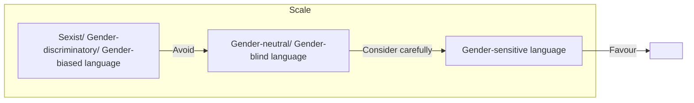

logo: European Institute for Gender Equality

logo: European Union

## **Toolkit on Gender-sensitive Communication**

**A resource for policymakers, legislators, media and anyone else with an interest in making their communication more inclusive**

---

## **The European Institute for Gender Equality**

The European Institute for Gender Equality (EIGE) is an autonomous body of the European Union established to strengthen gender equality across the EU. Equality between women and men is a fundamental value of the EU and EIGE’s task is to make this a reality in Europe and beyond. This includes becoming a European knowledge centre on gender equality issues, supporting gender mainstreaming in all EU and Member State policies, and fighting discrimination based on sex.

Email: eige.sec@eige.europa.eu

Tel. +370 52157444

logo: EIGE http://www.eige.europa.eu

icon: Twitter www.twitter.com/eurogender

icon: Facebook www.facebook.com/eige.europa.eu

logo: YouTube www.youtube.com/eurogender

icon: Eurogender http://eurogender.eige.europa.eu

icon: LinkedIn https://www.linkedin.com/company/eige/

European Institute for Gender Equality, EIGE
Gedimino pr. 16
LT-01103
Vilnius LITHUANIA

©Photo credits:
Cover: wellphoto / Shutterstock.com
p.12: davesdisco / Shutterstock.com
p.18: davesdisco / Shutterstock.com
p.23: tsyhun / Shutterstock.com
p.24: Jacob Lund / Shutterstock.com
p.25: sirtravelalot / Shutterstock.com (1); sirtravelalot / Shutterstock.com (2)
p.26: oneinchpunch / Shutterstock.com
p.27: FamVeld / Shutterstock.com
p.30: graphic-line / Shutterstock.com (1); stefanolunardi / Shutterstock.com (2);
ESB Professional / Shutterstock.com (3); Monkey Business Images / Shutterstock.com (4)
p.32: Aaron Amat / Shutterstock.com
p.36: Kekyalyaynen / Shutterstock.com
p.37: pathdoc / Shutterstock.com
p.39: AnastasiaMS / Shutterstock.com

Neither EIGE nor any person acting on behalf of EIGE is responsible for the use that might be made of the following information.

Luxembourg: Publications Office of the European Union, 2019

<u>Print ISBN 978-92-9482-362-5 doi:10.2839/373891 MH-01-19-609-EN-C</u>
PDF ISBN 978-92-9482-361-8 doi:10.2839/589287 MH-01-19-609-EN-N

© European Institute for Gender Equality, 2019
Reproduction is authorised provided the source is acknowledged.
Reuse is authorised provided the source is acknowledged, the original meaning is not distorted and EIGE is not liable for any damage caused by that use. The reuse policy of EIGE is implemented by the Commission Decision of 12 December 2011 on the reuse of Commission documents (2011/833/EU).

---

logo: EIGE European Institute for Gender Equality

## **Toolkit on Gender-sensitive Communication**

**A resource for policymakers, legislators, media and anyone else with an interest in making their communication more inclusive**

icon: stylized map of Europe and two star-shaped figures

---

## Contents

<table><tr><td>Chapter 1: Overview of the toolkit</td><td>3</td></tr>
<tr><td>Chapter 2: First steps</td><td>7</td></tr>
<tr><td>Chapter 3: Policy context</td><td>13</td></tr>
<tr><td>Chapter 4: Challenges</td><td>17</td></tr>
<tr><td>Chapter 5: Test your knowledge</td><td>37</td></tr>
<tr><td>Chapter 6: Practical tools (checklists and summary tables)</td><td>49</td></tr>
<tr><td>References</td><td>59</td></tr></table>

---

## **Chapter 1:**
### Overview of the toolkit

icon: stylized illustration of a globe showing Europe and Africa, with two human figures at the bottom

---

Chapter 1: Overview of the toolkit

Language is a reflection of the attitudes, behaviours and norms within a society. It also shapes people’s attitudes as to what is ‘normal’ and acceptable.

Women play an active role in society, yet – all too often – we use language that ignores or minimises their contribution. Words matter in shaping our worldview. For example the dominance of masculine words for general references can reflect assumptions about gender roles and influence readers (1).

**This toolkit is an easy-to-use guide on how to use more gender-sensitive language.**

**This toolkit is one of a series of documents produced by the European Institute for Gender Equality (EIGE) to raise awareness about gender-sensitive language. Other useful documents include a glossary to explain the meaning of key terms linked to gender equality and a thesaurus exploring the relationship between different terms, both accessible at:**
http://eige.europa.eu/rdc/thesaurus

## **Why use gender-sensitive language?**

In order to tackle gender inequality, we must look at the way we communicate. Using gender-sensitive language can:

* √ Make it easier to see important differences between the needs of women and men;
* √ Challenge unconscious assumptions people have about gender roles in society;
* √ Lay the foundation for greater gender equality throughout society;
* √ Raise awareness of how language affects our behaviour;
* √ Make people more comfortable with expressing themselves and behaving in ways that were once not considered ‘typical’ of their gender.

(1) Kutateladze Maia (2015), Importance of Gender-Sensitive Language and Some Guidelines for Business Writing, *Journal in Humanities*, 4(1), 21-24

4 European Institute for Gender Equality

---

Chapter 1: Overview of the toolkit

## **Purpose of the toolkit**

This toolkit provides guidelines for the use of gender-sensitive language in writing. Although it provides tips and examples for the English language, the underlying principles for gender-sensitive writing are universal and remain relevant when using other languages.

### ***Key objectives of the toolkit***

The key objectives of this document are to:

* √ raise awareness about the importance of gender-sensitive language;
* √ provide practical examples of what gender-biased and gender-discriminatory communication is and how to avoid it;
* √ provide practical tools and advice for policymakers and all those involved in the drafting of documents for the public so that these texts are gender-sensitive and inclusive for all members of the society;
* √ provide useful checklists and examples for users.

The toolkit can support a broad audience of international English speakers. However it focusses on policymakers, policy advisors, legislators, writers, editors and the media.

While we acknowledge that language should aim to be inclusive and reflect all members of society by acknowledging concepts such as age, ethnicity or nationality, this particular toolkit focusses on the gender dimension of language.

Toolkit on Gender-sensitive Communication 5

---

Chapter 1: Overview of the toolkit

## **What you will find in the toolkit and how to use it**

This toolkit provides practical guidance on how to use gender-sensitive language when writing documents and includes several examples.

We have divided the toolkit into six chapters:

icon: 1. Overview **Chapter 1** (the chapter you are reading right now) is here to help you understand what this toolkit is and how to use it.

icon: 2. First steps **Chapter 2** explains key terms you need to know to understand gender-sensitive language, as well as giving you the key principles that underpin inclusive language.

icon: 3. Policy context **Chapter 3** looks at the policies of European organisations that seek to encourage gender-sensitive language.

icon: 4. Challenges **Chapter 4** lays out common challenges when using gender-sensitive language and provides examples of gender-sensitive language and do’s and don’ts.

icon: 5. Test your knowledge **Chapter 5** enables you to test your understanding of the lessons from Chapter 4 through longer text examples.

icon: 6. Practical tools **Chapter 6** contains checklists and summary tables to help you understand if you are using ‘gender-savvy’ language in your writing

6 European Institute for Gender Equality

---

## **Chapter 2:**

### First steps

icon: illustration of a globe showing Europe and Africa resting on a star with two human figures

---

Chapter 2: First steps

## **Terms you need to know**

This chapter presents the **key terms you need to know** in order to make your language more inclusive. It also explains **why** we recommend that you mention gender in certain cases.

This chapter is designed to help you understand the **key principles behind using gender-sensitive language**.

This toolkit includes examples of three types of language that fall on an ‘inclusivity scale’. We discuss each of these terms further on the next page.

### **The inclusivity scale in language:**

flow_chart: Inclusivity scale diagram showing progression from sexist language to gender-sensitive language

Exclusive language

Inclusive language

We normally recommend that you aim to favour the most inclusive form of language: **gender-sensitive language**. In certain contexts it may also be acceptable to use gender-neutral language.

8 European Institute for Gender Equality

---

Chapter 2: First steps

**Gender-sensitive language** is gender equality made manifest through language. Gender equality in language is attained when women and men – and those who do not conform to the binary gender system – are addressed through language as persons of equal value, dignity, integrity and respect.

There are number of different ways gender relationships can be expressed with accuracy, such as avoiding the use of language that refers explicitly or implicitly to only one gender and ensuring, through inclusive alternatives, the use of gender-sensitive and inclusive language.

**Source:** EIGE Gender Equality Glossary and Thesaurus: http://eige.europa.eu/rdc/

## *Other forms of gender-discriminatory language*

Essentially, **sexist language** is the same as gender-discriminatory language. However there is a subtle difference in how people use the terms: sexist language is commonly seen as language that the user intends to be derogatory; gender-discriminatory language, on the other hand, also includes language people use without any sexist intention.\*

**Example of sexist language:** “Women must earn less than men because they are less intelligent.”

**Gender-biased** language either implicitly or explicitly favours one gender over another and is a form of gender-discriminatory language.

**Example of gender-biased language:** “Every day, each citizen must ask himself how he can fulfil his civic duties.”

**Gender-neutral language:** This is not gender-specific and considers people in general, with no reference to women or men. It is also called **gender-blind** language.

**Example of gender-neutral language:** “People do not fully appreciate the impact they have on the environment.”

**Gender-discriminatory language:** The opposite of gender-sensitive language. It includes words, phrases and/or other linguistic features that foster stereotypes, or demean or ignore women or men. At its most extreme it fails to treat the genders as equal in value, dignity, integrity and respect.

**Example of gender-discriminatory language:** “Ambassadors and their wives are invited to attend an after-dinner reception.”

\*From now on, to avoid confusion, we will refer only to gender-discriminatory language in this toolkit (not sexist language).

Toolkit on Gender-sensitive Communication 9

---

Chapter 2: First steps

## **Why should I ever mention gender?**

In practice it is not always easy to judge where your language falls on the inclusive/exclusive scale, so you may feel that it is safest to avoid any mention of gender altogether.

Indeed, as you will see in Chapter 4, we sometimes recommend gender-neutral expressions as **one way of avoiding gender-discriminatory language**, i.e. language that fosters stereotypes or demeans/ignores a gender. The logic here is: if we are treating women and men as equal, gender is ‘irrelevant’ to the discussion and we should not state it explicitly. This is true in many cases, particularly when discussing occupations.

icon: thumbs up One potential benefit of gender-neutral language is that it can be more inclusive to those who do not identify in a binary way with one gender. The use of ‘they’ and the development of new gender-neutral pronouns (such as ‘zhe’) is another step in this direction.

icon: thumbs down Although gender-neutral/gender-blind language can be appropriate in certain situations, it comes with **clear downsides**. It often takes the male perspective as its basis and can therefore hide important differences in the roles, situations and needs of women/girls and men/boys. Gender-blind projects, programmes and policies do not take into account these diverse roles and needs. They can maintain the status quo and fail to help transform the unequal structure of gender relations.\* In this respect, only **gender-sensitive language** is likely to be up to the task.

\*Based upon the definition of ‘gender blindness’ in EIGE’s Gender Equality Glossary and Thesaurus: http://eige.europa.eu/rdc/thesaurus

10 European Institute for Gender Equality

---

Chapter 2: First steps

## **Choosing whether to mention gender**

You will have to decide whether to include gender explicitly on a case-by-case basis.

Guiding questions for choosing between gender-neutral and gender-sensitive language:

* **Will mentioning gender shed light on key aspects of the issue you are discussing?** If so, use gender-sensitive language. If not, use gender-neutral language.
* **Are you referring to people in general or a specific group?** If you are mentioning people in general, it may be acceptable to use gender-neutral language (in some cases), whereas if you are mentioning a specific group it is usually relevant to discuss gender.
* **Are you explicitly aiming to be inclusive to those of a non-binary gender?** If so, you may wish to opt for gender-neutral language (particularly the third person plural: “they”, “them”, etc.) or else to use gender-sensitive language that includes this group, making use of inclusive new terms such as “zhe” or “e”.

#### **Tip!**

We recommend that **law-** and **policymakers** always aim to use **gender-sensitive** language rather than gender-neutral language. Giving visibility to gender is an important way for public policy to positively affect all members of society. The gender perspective may not immediately be obvious, but there is almost always an important gender dimension to public policy.

#### **Tip!**

Do not automatically assume transgender people identify as ‘non-binary’. Many transgender people do identify with one gender; this gender may just differ to the one assigned to them at birth.

#### **Tip!**

If you introduce a gender dimension to your policy or programme, you should aim to **research differences in the actual situation of women and men** (based on statistical information and other relevant research), rather than guessing or assuming what these differences are. This will enable you to assess specific needs more effectively and design your policies and programmes in a gender-sensitive way.

Toolkit on Gender-sensitive Communication 11

---

Chapter 2: First steps

## **Key principles for inclusive language use**

You should aim to follow these principles if you wish to make your language inclusive and transformative:

1. Recognise and challenge **stereotypes**.
2. Be inclusive and avoid **omission** and making others **invisible**.
3. Be respectful and avoid **trivialisation** and **subordination**.

If you succeed in following these principles you are well on your way to becoming a user of gender-sensitive language and you should find yourself naturally following the rest of the guidance in this toolkit.

**Tip!**
We consider these principles throughout Chapter 4.

12 European Institute for Gender Equality

---

## **Chapter 3:**
### Policy context

icon: stylized illustration of a globe showing Europe and Africa, with two human figures at the bottom

---

Chapter 3: Policy context

## **Gender equality policies in the EU**

This chapter aims to give you a sense of the **policy context** behind this toolkit, and in particular the action European organisations have taken to encourage greater use of gender-sensitive language.

This chapter is designed to help you understand the **wider picture** into which your work fits.

The European Union (EU) aims to **combat stereotypes** and to promote gender equality through **equal treatment legislation, gender mainstreaming,** and **measures for the advancement of women.** In 1996 the European Commission committed itself to promoting gender equality in all its policies and activities. In 2006 the first ‘Pact for Gender Equality’ was published and in 2008 the European Commission published its Communication ‘Non-discrimination and equal opportunities: A renewed commitment’ that includes different activities to fight discrimination. The most recent ‘Strategic Engagement for Gender Equality 2016-2019’ identifies five priority areas for action, focussing on: equal economic independence, equal pay, equality in decision-making, an end to gender-based violence, and greater gender equality beyond the EU.

icon: signature mark

A number of policies provide guidelines on gender-sensitive communication and the portrayal of **women in the media.** For example the ‘Audio-visual Media Services Directive (2010/13/EU)’ bans incitement to hatred on the grounds of race, sex, religion and nationality in the media and urges EU Member States to ensure that media services within their jurisdiction do not include any of the above. The opinion of the European Commission’s Advisory Committee on Equal Opportunities for Women and Men on breaking gender stereotypes in the media recommends that students of journalism and media staff receive training on how to use gender-sensitive language.

icon: document icon

14 European Institute for Gender Equality

---

Chapter 3: Policy context

## **Existing EU language guidelines**

<table><tr><th>Publication</th><th>Content</th></tr>
<tr><td>icon: documents <strong>EU Inter- institutional Style Guide</strong></td><td>The Publications Office of the EU has published instructions on gender-neutral language in its style guide.  The focus is on gender-neutral drafting of texts and it includes useful writing tips.  It is currently only available in English language.  Source: <u>http://publications.europa.eu/code/en/en-4100600en.htm</u></td></tr>
<tr><td>icon: folder <strong>English Style Guide by the Directorate-General for Translation</strong></td><td>The English style guide is a handbook for authors and translators in the European Commission and includes a section on gender-neutral language.  It includes the same guidelines as the EU Inter-institutional style guide.  Source: <u>https://ec.europa.eu/info/sites/info/files/styleguide_english_dgt_en.pdf</u></td></tr>
<tr><td>icon: document <strong>Fundamental Rights Agency Style Guide for Authors</strong></td><td>The style guide includes a section on avoiding discriminatory and offensive language and using gender-neutral language.  Source: <u>https://fra.europa.eu/sites/default/files/annex_2_to_annex_a1_-_fra_style_guide_for_authors.pdf</u></td></tr></table>

Toolkit on Gender-sensitive Communication 15

---

Chapter 3: Policy context

## **Steps at the national level**

There are **some national policies and initiatives** that aim to combat gender stereotypes in different areas of public work.

Many **institutions (such as universities or ministries)** in EU Member States issue guidelines regarding the use of non-discriminatory and gender-neutral language.

icon: thumbs up The Portuguese public broadcasting corporation delivered training on gender equality and non-sexist language for its workers.

icon: thumbs up The Austrian Ministry of Science, Research and Economy has issued guidelines on non-discriminatory language use with regard to gender, age, sexual orientation, and ethnicity.

icon: thumbs up The High Council for Gender Equality in France published guidelines on how to avoid gender stereotypes in public communication.

> The European Institute for Gender Equality (EIGE) aims to increase understanding of what gender-sensitive communication is and how to use it.

16 European Institute for Gender Equality

---

## **Chapter 4:**
## Challenges

icon: stylized illustration of a globe showing Europe and Africa, with two human figures at the bottom

---

Chapter 4: Challenges

## **Common challenges when using gender-sensitive language**

This chapter presents the most common stumbling blocks when trying to write in a gender-sensitive manner.

This chapter is designed to help you understand the issues which lead to language being gender-discriminatory so that you can recognise it when you see it.

> ### **Non-linguistic communication**
>
> There are many ways of communicating and we include some reference to other forms of visual communication, such as images and emojis.

> ### **Tip!**
>
> Chapter 6 contains a table of solutions to help you use gender- sensitive language on a day-to-day basis.

### **Categories of gender-discriminatory language**

There are three broad categories under which much gender-discriminatory language falls:

* **Stereotypes:** assigning gender when gender is unknown or irrelevant as a result of stereotypes.
* **Invisibility and omission:** language which casts the male as the generic norm and keeps women from being visible in public life.
* **Subordination and trivialisation:** language which paints one gender, often women, as inferior, or belittles them.

These three categories are very closely related. In fact, invisibility, omission, subordination and trivialisation stem from gender stereotypes and can reflect attitudes held across society.

> ### **Tip!**
>
> Always ask yourself if what you are saying could fall into any of these categories – if so, think of a different way to express yourself.

18 European Institute for Gender Equality

---

Chapter 4: Challenges

## **Stereotypes: How language manifests gender-related stereotypes**

Stereotypes are generalised images about people within a society. A gender stereotype is a preconceived idea where women and men are assigned characteristics and roles determined and limited by their gender.

Stereotypes about gender often take one of two forms. One assumes all members of a category (such as a profession) share a gender, for example the assumption that all company directors are men and all secretaries are women. The other is assuming that all members of a gender share a characteristic, for example believing that all women love to shop or that ‘boys don’t cry’.

**These stereotypes hurt people of all genders by placing expectations on what people should be.**

In many cases unconscious cultural stereotypes will be expressed through the language we use, meaning people use these expressions even when they do not hold these assumptions.

**Repeating these stereotypes reinforces the assumptions at their core, therefore you should actively avoid stereotypes in the language you use.**

The sections below highlight some instances where you may come across gender stereotypes in language.

* By using gendered pronouns.
* Adding irrelevant information about gender in a description of an individual.
* Assigning gender to inanimate objects.
* Using gender stereotypes to describe objects or events.
* Describing people of different genders using different adjectives (descriptive words).
* Perpetuating stereotypes in non-verbal communication, such as images and symbols.

photo: a man wearing a headset in an office setting

> “I need to speak to the secretary - is she in the office?”

#### **Tip!**
Professions and occupations are often gender stereotyped. Take special care to avoid stereotypes when talking about people’s occupations.

Toolkit on Gender-sensitive Communication 19

---

Chapter 4: Challenges

## **Avoiding stereotypes:**
## **Avoid gendered pronouns (he or she)**
## **when the person’s gender is unknown**

When using a gendered pronoun (e.g. he or she), the speaker is assuming the gender of the person they are talking about. Often people use gendered pronouns even when they do not know the gender of the person they are talking about or when talking about a group of people that could be of either gender.

This practice perpetuates **gender stereotyping** by repeating commonly held expectations about the gender of people in certain roles.

Instead you should use gender-neutral language. A common way to do this is to use the plural ‘they’. This is becoming more and more common in standard English.

#### ***Examples***

##### ***Gender-discriminatory language***
❌ The number of years an electrician will spend training depends on what country he is from.

##### ***Gender-neutral language***
✔ The number of years an electrician will spend training depends on what country they are from.

##### ***Gender-discriminatory language***
❌ Every nurse should take care of her own uniform and cover the expense herself.

##### ***Gender-sensitive language***
✔ Every nurse should take care of his or her own uniform and cover the expense themselves.

> **Tip!**
>
> Do not rely on “he/him/man” when talking about an individual in the abstract – this excludes women from the conversation.

Gendered pronouns come in a few forms (she or he, hers or his, herself or himself, her and him). See Chapter 6 for a full list.

“Your boss needs to know he can rely on you.”
“But my boss is a woman...”

photo: a group of people in a meeting around a table with a laptop

20 European Institute for Gender Equality

---

Chapter 4: Challenges

## **Avoiding stereotypes:**
## **Avoid irrelevant information about gender**

When you are speaking or writing about occupations, do not provide irrelevant information about people’s gender. Doing this supports the stereotype that the ‘normal’ version of this profession is gendered. For example, saying ‘female lawyer’ implies that lawyers are normally male.

For this reason terms such as *female professor* or *male nurse* should not be used. **Instead you should simply use the occupation title with no gender description.**

#### ***Examples***

**Gender-discriminatory language**
❌ The eco-action group chairman Moni Patel works closely with the chairman of the social action committee Matthieu Dubois to plan events.

**Gender-neutral language**
✔ The eco-action group chair Moni Patel works closely with the chair/chairperson of the social action committee Matthieu Dubois to plan events.

**Gender-discriminatory language**
❌ Priti is a career woman.\*

**Gender-sensitive language**
✔ Priti is focussed on her career.

**Another common way that gender is included in writing about people when it is not relevant is through using gendered nouns.** These are nouns which imply the gender of the person (e.g. policeman and policewoman). Avoid using these nouns to describe people and use something gender-neutral instead (e.g. police officer).

image: diagram showing gendered and neutral terms for a judge

#### **Tip!**

There is usually no reason to include someone’s gender when speaking about a professional – just leave it out!

\*The term career woman is gender-discriminatory and should never be used. It carries extra information that suggests it is unusual for a woman to be career-focussed and is insulting to women – one never hears of a ‘career man’.

**A list of common gendered nouns and some alternatives is provided in Chapter 6.**

Toolkit on Gender-sensitive Communication 21

---

Chapter 4: Challenges

## **Avoiding stereotypes: Avoid gendered stereotypes as descriptive terms**

Avoid using words which imply a gender connotation to describe an aspect of a person or object. It is especially important to avoid doing this where the gendered term is used as an insult.

These expressions normally paint the feminine as the negative. Describing something as feminine is used as an insult, often to mean weak or ineffective. Using language in this way is sexist. Do not employ gender stereotypes to describe the way something is or the way the action is done.

#### ***Examples***

**Gender-discriminatory language**
❌ Paul’s ladylike handshake did not impress his new boss, who believes salespeople need a firm handshake.

**Gender-sensitive language**
✔ Paul’s weak handshake did not impress his new boss, who believes salespeople need a firm handshake.

**Gender-discriminatory language**
❌ You throw like a girl.

**Gender-sensitive language**
✔ You do not throw well.\*

**Gender-discriminatory language**
❌ The team taking part in the charity obstacle course who were scared of the cold water had to man up and dive in at the first obstacle.

**Gender-neutral language**
✔ The team taking part in the charity obstacle course who were scared of the cold water had to be tough and dive in at the first obstacle.

\*This is the implied usage of the phrase ‘like a girl’ in English, to do something badly or in a silly or weak manner. Some campaigners are trying to reclaim this phrase to show the positive side of being ‘like a girl!’

photo: a young man performing a basketball dunk

Scoring like a girl

22 European Institute for Gender Equality

---

Chapter 4: Challenges

## **Avoiding stereotypes: Gendering inanimate objects**

Assigning a gender to an inanimate object by using gendered pronouns to discuss it applies cultural connotations to characteristics. These connotations are related to gender stereotypes and help to perpetuate them.

You should use the pronoun *it* to talk about inanimate objects.

#### ***Examples***

**X** ***Gender-discriminatory language***
The ship slipped her moorings.

**✓** ***Gender-sensitive language***
The ship slipped its moorings.

**X** ***Gender-discriminatory language***
Delegates are free to make presentations in their mother tongues and translations will be provided.

**✓** ***Gender-sensitive language***
Delegates are free to make presentations in their native languages and translations will be provided.

**X** ***Gender-discriminatory language***
Last month, France and her citizens woke up to heavy snowfall.

**✓** ***Gender-sensitive language***
Last month, France and its citizens woke up to snowfall.

#### **Tip!**

When personifying inanimate objects (i.e. for a cartoon story) think: what objects have been given a gender and is this based on stereotypes? It is also important to include both female and male characters rather than treating the male as neutral.

photo: two children in pirate costumes on a log raft in a river

All aboard our gender-neutral ship!

Toolkit on Gender-sensitive Communication 23

---

Chapter 4: Challenges

## **Avoiding stereotypes: Using different adjectives for women and men**

Sometimes in English different adjectives are used to describe the same feature in women and men. There are also some words which – despite not having an explicit gender – have strong connotations that are strongly associated with only women or men.

This stems from the fact that some character traits, such as being ambitious, are considered by society attractive in men but negative in women.

It is not always easy to spot when adjectives are promoting gender stereotypes. The examples in the table below show some words to look out for and to avoid using to describe women.

> **Tip!**
>
> When describing a characteristic of a woman, ask yourself, ‘would I ever use this word to describe a man?’ (and vice versa) If not, then look for a term without gender connotations.

### **Semantic non-equivalence**

These are words in English that are supposed to be equivalent, but actually the female versions of the words have gained negative connotations over the years. You should think carefully about the connotations of words before using them. For example, consider:

<table><tr><td>governor</td><td>governess</td></tr>
<tr><td>master</td><td>mistress</td></tr>
<tr><td>patron</td><td>matron</td></tr>
<tr><td>sir</td><td>madam</td></tr>
<tr><td>bachelor</td><td>spinster</td></tr>
<tr><td>host</td><td>hostess</td></tr></table>

### **Adjectives with gender connotations to avoid:**

<table><tr><th><strong>Adjectives commonly used</strong> <strong>for women (derogatory)</strong></th><th><strong>Better language</strong></th></tr>
<tr><td>Bossy or pushy</td><td>Assertive</td></tr>
<tr><td>Loose</td><td>Having sexual confidence – no male equivalent</td></tr>
<tr><td>Emotional or hormonal</td><td>Passionate, enthusiastic, empathetic</td></tr>
<tr><td>Ditzy</td><td>Silly</td></tr>
<tr><td>Frigid</td><td>Lacking sexual responsiveness – no male equivalent</td></tr>
<tr><td>Frumpy</td><td>Dowdy and old-fashioned</td></tr>
<tr><td>Shrill</td><td>High-pitched, grating voice</td></tr>
<tr><td>Hysterical</td><td>Irrational</td></tr></table>

24 European Institute for Gender Equality

---

Chapter 4: Challenges

## **Avoiding stereotypes:**
## **Avoid using stereotypical images**

We communicate ideas about the world not only through language, but also through the images we choose to use. A piece of communication is gender-discriminatory if the people within the images are only depicted in stereotypical ways (i.e. female home makers, male builders).

Make sure that that the images you use in your communication material do not reinforce gender stereotypes by including a wide mix of people in different environments.

There are some more examples on the next page to help you understand this distinction.

#### **Tip!**

Make sure you are using the most up-to-date version of your chosen emoji software – this will give you the widest range of options which will help you make a gender-sensitive choice.

#### **Emojis**

Many people use emojis (or emoticons) to express themselves when communicating electronically. Many of these emoji sets repeat stereotypes by putting men in active roles (sports people, or professionals) and only including women in stereotypical pursuits (cutting hair or dancing), or not including women at all. Some providers now include more options so that you can make more inclusive and gender-sensitive choices. When you use emojis remember these are also a way to make your communication supportive of gender equality.

icon: row of emojis showing men in active roles and women in stereotypical pursuits

SCIENCE: IT'S A GIRL THING!

Original video has been taken down, this image was sourced from: https://www.youtube.com/watch?v=zj-FFZngUk

#### **Tip!**

Colours are often arbitrarily connected to one gender, such as pink for women and blue for men. When designing communication materials, check the colours you have used and don't use colour as a shorthand for gender. See the example on the left for a public campaign that used stereotypical colours and images to reach out to women and girls.

Toolkit on Gender-sensitive Communication 25

---

Chapter 4: Challenges

## **Avoiding stereotypes:**
## **Avoid using stereotypical images**

The images on the left depict stereotypical images of doctors as male and nurses as female. In order to be gender-inclusive, it may be a good idea to have more than one person in your image.

image: A 2x2 grid of images comparing stereotypical (marked with X) and inclusive (marked with ✓) depictions of medical professionals.

26 European Institute for Gender Equality

---

Chapter 4: Challenges

## **Avoiding Invisibility or Omission: Do not use ‘man’ as the neutral term**

The term *man* is sometimes used to describe the experience of all human beings.

However this practice ignores the experience of women as equal members of the human race and contributes to their omission from public life. It can have a real impact on their lives, for example if the word ‘man’ is used throughout a job advert a woman may be less likely to apply.

**You should not use ‘man’ to refer to the experiences of all people.**

#### *Examples*
#### ***Gender-discriminatory language***
❌ Fire is man’s greatest invention.

#### ***Gender-neutral language***
✔ Fire is humanity’s greatest invention.

> **Tip!**
>
> When writing about the history of human achievement it is very important not to use the male as generic, otherwise it would seem that all major advances have been made by men and women have not contributed anything to humanity’s progress.

‘Man’ is cast as generic in several stock expressions; try rewording them to make them applicable to all people.

#### *Examples*
#### ***Gender-discriminatory language***
❌ Under the law, all men are equal.

#### ***Gender-neutral language***
✔ Under the law, all people are equal.

#### ***Gender-sensitive language***
✔ Under the law, all women and men are equal.

<table><tr><th><strong>Gender-</strong> <strong>discriminatory</strong> language</th><th><strong>Better language</strong></th></tr>
<tr><td>Man in the street</td><td>Average person</td></tr>
<tr><td>Every man for himself</td><td>Everyone for themselves</td></tr>
<tr><td>Mankind</td><td>Humankind</td></tr>
<tr><td>To a man</td><td>Every person</td></tr></table>

See Chapter 6 for examples of situations where women may be subject to invisibility or omission, as well as alternatives you can use.

Toolkit on Gender-sensitive Communication 27

---

Chapter 4: Challenges

## **Avoiding Invisibility or Omission: Do not use ‘he’ to refer to unknown people**

Using *‘man’* to mean all people collectively propagates the invisibility and omission of women; using *‘he’* to represent any given individual does the same.

**Avoid using ‘he’ when referring to the generic experience of all people as this removes women from the common experience.**

*“Each applicant must submit **his** resumé.”*
*“Hmm, I guess it’s not for me.”*

photo: a woman looking at a laptop with a pen in hand

#### ***Example***

**Gender-discriminatory language**
❌ The responsible citizen will report anything suspicious he sees to the police.

**Gender-sensitive language**
✔ The responsible citizen will report anything suspicious she or he sees to the police.

**Gender-discriminatory language**
❌ Each applicant must submit his resumé.

**Gender-sensitive language**
✔ Each applicant must submit his or her resumé.

#### **Tip!**

Some people have started to use gender-neutral pronouns in place of traditional gender pronouns.

One example of this is ‘ze’.

E.g. Ze, Hir, Hirs, Hirself

E.g. ‘Ze does hir homework hirself’.

This can be a way of including people of non-binary gender in the discussion.

See Chapter 6 for more solutions to avoid gendered pronouns.

28 European Institute for Gender Equality

---

Chapter 4: Challenges

## **Avoiding Invisibility or Omission: Do not use gender-biased nouns to refer to groups of people**

Gendered nouns and adjectives used to denote generic experiences encourage us to view the world as mainly having relevance to men. The word ‘manmade’ equates the word ‘man’ with ‘human’. The term ‘postman’ suggests all postal workers are men. In a gender-equal society it is important to use language that recognises that these posts can be held by women or men.

**Gendered nouns and adjectives should be avoided and replaced with gender-neutral terms.**

<table><tr><th><strong>Gender-</strong> <strong>discriminatory</strong> language</th><th>Gender-neutral language</th></tr>
<tr><td>Policeman or policewoman</td><td>Police officer</td></tr>
<tr><td>Businessman or businesswoman</td><td>Business executive</td></tr>
<tr><td>Repairman</td><td>Repairer, technician</td></tr>
<tr><td>Steward or Stewardess</td><td>Flight attendant</td></tr>
<tr><td>Salesman</td><td>Salesperson, sales clerk</td></tr>
<tr><td>Workman</td><td>Worker</td></tr></table>

#### **Tip!**

English gives you the option to make generic terms apply to women as well, e.g. ‘landlord’ or ‘landlady’, but it is generally better to use a gender-neutral term for most professions.

<table><tr><td><strong><em>Example</em></strong>  <strong><em>Gender-discriminatory language</em></strong>  ❌ Manmade fabrics can actually require less manpower to produce than natural fabrics.  <strong><em>Gender-neutral language</em></strong>  ✔ Synthetic fabrics can actually require fewer human resources to produce than natural fabrics.  <strong><em>Gender-discriminatory language</em></strong>  ❌ The forefathers of today's villagers used the same methods for catching fish as today's villagers.  <strong><em>Gender-neutral language</em></strong>  ✔ The ancestors of today's villagers used the same methods for catching fish as today's villagers.</td><td><strong>Tip!</strong>  When referring to a mixed gendered group you should avoid the phrase 'the guys' as this takes the male as generic and representative of the whole group.</td></tr></table>

Toolkit on Gender-sensitive Communication 29

---

Chapter 4: Challenges

## **Avoiding Invisibility or Omission: Take care with ‘false generics’**

Although gender-neutral language can be a way of overcoming the use of the male as generic, this form of language is not always appropriate. It may ignore key gender elements of the subject under discussion. Furthermore, although the language may appear to be neutral, custom may mean that in practice people continue to interpret a generic reference (such as ‘people’) to mean men.

<table><tr><th><strong>Examples of</strong> gender-neutral language</th><th><strong>Why gender-neutral language</strong> <strong>may be inappropriate in this</strong> context</th><th><strong>Better language</strong> <strong>(gender-sensitive)</strong></th></tr>
<tr><td><strong>In 2014, 14% of people aged 18-65 stated that they had experienced sexual violence in the previous year.</strong></td><td>This language may obscure the fact that women are disproportionately exposed to sexual violence and result in support services not being designed in a way that takes this into account. For example insufficient numbers of women doctors may be employed to examine victims. And if sexual violence is a relatively uncommon experience for men, male victims may need extra support to come forward.</td><td><strong>In 2014, 23% of women and 5% of men aged 18-65 stated that they had experienced sexual violence in the previous year.</strong></td></tr>
<tr><td><strong>Lithuania is playing well today and likely to win the match. Lithuania’s women will also be playing tomorrow.</strong></td><td>Appears to refer to people in general but actually refers only to men, due to the stereotype that men playing sports is the ‘norm’. In contrast when women play sports their gender will often be made explicit, as this is seen as ‘atypical’ (“Lithuania’s women”). This runs the risk of further entrenching common stereotypes. There is no ideal linguistic solution here. To challenge stereotypical thinking it is important either to mention gender when referring to both women and men in sports, or not to mention gender at all (including when the players are women). In this case, in order to avoid confusion it is probably easiest to mention gender in both cases.</td><td><strong>Lithuania’s men are playing well today and likely to win the match. Lithuania’s women will also be playing tomorrow.</strong></td></tr></table>

30 European Institute for Gender Equality

---

Chapter 4: Challenges

**Consider:** If all countries interpreted the Universal Declaration of Human Rights (1948) as applying to all people, why was a separate human rights treaty on women’s rights (CEDAW) needed more than thirty years later?

### **Tip!**

As mentioned in Chapter 2, we recommend that **law** and **policymakers** always aim to use **gender-sensitive** language rather than gender-neutral language. Giving visibility to gender is an important way for public laws, policies and programmes to reach out more effectively to all members of society. It may be that the gender perspective is not immediately obvious, but there is almost always an important gender dimension to all public policies.

Toolkit on Gender-sensitive Communication 31

---

Chapter 4: Challenges

## **Avoiding Invisibility or Omission: Greetings and other forms of inclusive communication**

There are many ways to make sure that all your communication material feels like it is aimed at all people, not just one gender.

When creating a piece of communication material, consider:

* **Choice of voice-over artist.** Consider if the gender of the voice-over is perpetuating stereotypes, such as using only a male voice to impart information. Aim for a mix of genders.
* **Choice of photographs/drawings/images.** Think about whether they are repeating stereotypical gender roles or whether they only include one gender.
* **Gender of individuals given in examples.** Try to ensure that the individuals in examples show a mix of genders in different roles. I.e. ensure that men are not always in positions of power in a given scenario.

### ***Greetings***

English speakers have traditionally been taught to use the male gender when the gender of the person they are speaking to is unclear. However it is more inclusive to acknowledge that the recipient may be of either gender.

Instead of using *Dear Sir*, the gender-sensitive writer should use: *Dear Sir or Madam or Dear Madam or Sir*.

photo: a woman looking at a large stack of papers

“These are all addressed to **‘Dear Sir’**, so nothing to do with me!”

32 European Institute for Gender Equality

---

Chapter 4: Challenges

## **Subordination and trivialisation: How language can reinforce the subjugation of women**

Subordination and trivialisation are ways of using language that reinforce men’s traditional dominance over women or belittle or insult women.

Trivialisation is any language which makes something seem unimportant and it is closely related to subordination. Often things related to women are trivialised through language that make something sound ‘small’ or ‘cute’. This may appear benign, but can have the effect of reinforcing women’s subordinate place in society.

**Take care that your language actively promotes gender equality by not trivialising or subordinating women.**

Some key aspects of language to watch out for are:

* Naming conventions, titles and how to refer to people.
* Word or phrase hierarchy.
* Diminutive affixes.
* Terms for women.

Don't call me baby.

Toolkit on Gender-sensitive Communication 33

---

Chapter 4: Challenges

## **Subordination and trivialisation: Naming conventions**

Traditional titles for women, Mrs (married) or Miss (single), used to refer to their marital status, whereas the term for men, Mr, was neutral in this regard (either married or single). This naming convention signals a woman’s relationship to a man within her name, inviting the hearer to consider this as part of who she is, rather than presenting her as an individual. The term Ms avoids this, which, like Mr, does not denote marital status.

**When referring to women you should generally use the term Ms (which does not denote marital status).**

Another point to look out for in writing is referencing. When referring to a woman, use the same conventions as you would when referring to a man. Using a first name to refer to a woman when you have used a surname for a man indicates a lack of respect for the woman in comparison to the man.

**Always use the same naming conventions for men and women.**

Sometimes people refer to women in relation to men. Avoid doing this by ensuring that you are always referring to women as people in their own right.

#### ***Example***

icon: red X ***Gender-discriminatory language***
Mr and Mrs Alistair Farrar will be attending this evening.

icon: blue checkmark ***Gender-sensitive language***
Jessica Farrar and Alistair Farrar will be attending this evening.

icon: red X ***Gender-discriminatory language***
Yang and his research assistant Holly were pioneering social researchers.

icon: blue checkmark ***Gender-sensitive language***
Yang and his research assistant Smith were pioneering social researchers.

#### **Tip!**

The terms ‘maiden name’ and ‘married name’ reflect the tradition of a woman changing her name to match her husband's and make relationship status an integral part of a woman's name. Instead just refer to someone’s ‘last name’.

#### **Tip!**

Some women may choose to refer to themselves using Miss or Mrs. If someone refers to themselves in this way, you should use the same title when referring to them.

34 European Institute for Gender Equality

---

Chapter 4: Challenges

## **Subordination and trivialisation: Word phrase hierarchy**

Some pairs of words and phrases are habitually used in a fixed order, usually with the male version appearing first. This reflects and reinforces the cultural value assigned to each. You should try to avoid repeating these word pairings in the order that they are heard.

These example phrases are not always gender-discriminatory but because they are always said this way they have become so.

**You should be aware of the word order of your phrases and make sure that you are not always putting the male version first.**

#### ***Example***

##### ***Gender-discriminatory language***
icon: red X
The husband and wife team established the charity themselves. The man and woman, both affected by the issue, decided to do something to help others.

##### ***Gender-sensitive language***
icon: blue checkmark
The wife and husband team established the charity themselves. The man and woman, both affected by the issue, decided to do something to help others.

#### **Phrases to look out for**

* King and Queen
* Men and women
* Ladies and gentlemen
* Boys and girls

photo: playing cards showing King of Spades, King of Hearts, and Queen of Hearts

> **Tip!**
>
> Although it might seem awkward at first, consider switching the order of these phrases each time you use one.

See Chapter 6 for longer lists of words/phrases to look out for!

Toolkit on Gender-sensitive Communication 35

---

Chapter 4: Challenges

## **Subordination and trivialisation: Patronising language**

One example of trivialisation is the additions of diminutive affixes to denote that the referent is female. Gender-sensitive writers should avoid these expressions as they can trivialise women.

#### ***Example***
#### ***Gender-discriminatory language***

icon: red X The usherette helped me to my seat just as the actress came on stage.

#### ***Gender-sensitive language***

icon: blue checkmark The usher helped me to my seat just as the actor came on stage.

> **Tip!**
>
> Think about the meaning of the words *kitchenette* and *novelette* compared to the words *kitchen* and *novel* to see the effect of the *-ette* suffix.

Language which refers to people unknown to you in terms of endearment (‘My dear’, ‘Darling’, ‘Love’, and ‘Dear’ when used in speech) is patronising, condescending and promotes trivialisation. These forms should not be used unless the interlocutor has a close relationship with the speaker.

Another common way of trivialising women is to refer to adult women as ‘girls’. This is patronising and should be avoided.

Additionally, sometimes the word ‘woman’ is used dismissively e.g. *‘Get out of my way, woman!’*

As well as avoiding obvious gender insults you should take care to avoid patronising women using more innocuous terms.

#### ***Example***
#### ***Gender-discriminatory language***

icon: red X I’ll get one of the girls from my office to help me move the boxes.

#### ***Gender-neutral/sensitive language***

icon: blue checkmark I’ll get one of the gang from my office to help me move the boxes.
*Or*
I’ll get one of the women from my office to help me move the boxes.

See Chapter 6 section on gendered nouns for other phrases to look out for!

36 European Institute for Gender Equality

---

## **Chapter 5:**

### Test your knowledge

icon: illustration of a globe showing Europe and Africa, with two stylized human figures at the bottom

---

Chapter 5: Test your knowledge

## **Test your knowledge**

This chapter is designed to **test your knowledge and understanding** of some of the key lessons from Chapter 4.

It includes longer examples with many forms of gender-discriminatory language. For each example we encourage you to:

* Read through carefully and count how many times you see language being used in a gender-discriminatory way;
* Think about how the text could be more inclusive;
* Read on for the answers.

38 European Institute for Gender Equality

---

Chapter 5: Test your knowledge

## **Example 1**

The example below is a policy document from the fictional country of Michland. How many examples of gender-discriminatory language does it contain? Where are they?

### **Preamble**

Precarious employment is arguably man’s greatest challenge in the modern age. Michland is still recovering from the effects of the recent economic crisis, but the benefits have not been equally shared amongst her citizens. Although unemployment has started to fall, the rise of low-pay, insecure jobs is threatening the ability of families to make ends meet. More and more families are facing poverty and insecurity, through no fault of their own. This development is wreaking havoc on workers from all occupations – from builders and policemen through to teachers and even waitresses.

On 1 November 2000, a spokesman for the President stated:

*“The failures of the last government have left many families struggling. Our social inclusion strategy embodies the virile action needed to overcome the spectre of precarious employment and give everyone a decent chance in life”*

This strategy aims to ensure that:

* Every employee has sufficient income and social protection to protect himself from poverty;
* There are adequate measures to support the work-life balance of women;
* Early years interventions are in place for parents and children at risk of poverty;
* Boys and girls everywhere have access to a decent education, regardless of their income.

**Review:** How many instances of gender-discriminatory language did you count?

See the next page for the answer...

Toolkit on Gender-sensitive Communication 39

---

Chapter 5: Test your knowledge

## **Example 1**

In total, there are **7** examples of clear gender bias (circled red below) and **2** examples (circled yellow) that could be classed as such. We explain below next to the red arrows why the author may wish to change his/her language.

**Preamble**

Gendering of an inanimate object (country).

Precarious employment is arguably **man’s** greatest challenge in the modern age. Michland is still recovering from the effects of the recent economic crisis, but the its have not been equally shared amongst **her** citizens. Although unemployment has started to fall, the rise of low-pay, insecure jobs is threatening the ability families to make ends meet. More and more families are facing poverty and rity, through no fault of their own. This development is wreaking havoc on rs from all occupations – from builders and police**men** through to teachers and even waitresses.

Casting the male as generic and focusing only on the experiences of men and boys.

Gendered occupation is being used even though not all waiting staff are women.

Not necessary to gender this occupation, as gender is irrelevant.

In **December 2000**, a **spokesman** for the President stated:

Gendered occupation is being used even though not all police officers are men.

*res of the last government have left many families struggling. Our social inclusion strategy embodies the* **virile** *action needed to overcome the spectre of precarious employment and give everyone a decent chance in life”*

Gendered adjective.

This strategy aims to ensure that:

* Every employee has sufficient income and social protection to protect **himself** from poverty;
* There are adequate measures to support the work-life balance of **women**;
* Early years interventions are in place for parents and children at risk of poverty;
* **Boys and girls** everywhere have access to a decent education and income.

Clear gender bias – reflects notion that all employees are men.

It is positive that the strategy includes specific measures to support women, but the rationale behind these measures needs to be clear to ensure that they are not based on, nor reinforce stereotypical thinking.

The phrasing here could also be better. Is the work-life balance of men not important? Are the authors assuming that women and men have different responsibilities and, if so, is it right for them to make that statement in an unqualified way?

There is nothing wrong with the phrase ‘boys and girls’ in itself, but when it is always said in this order it can become gender-discriminatory, as it affects the cultural value assigned to each gender. Sometimes it is worthwhile to switch the order around.

40 European Institute for Gender Equality

---

Chapter 5: Test your knowledge

## **Example 1 - corrected text**

The text below shows the same policy document, this time with the language improved to be more gender-sensitive and inclusive.

### **Preamble**

Precarious employment is arguably **humanity’s** greatest challenge in the modern age. Michland is still recovering from the effects of the recent economic crisis, but the benefits have not been equally shared amongst **its** citizens. Although unemployment has started to fall, the rise of low-pay, insecure jobs is threatening the ability of families to make ends meet. More and more families are facing poverty and insecurity, through no fault of their own. This development is wreaking havoc on workers from all occupations – from builders and **police officers** through to teachers and even **waiting staff**.

On 1 November 2000, a **spokesperson** for the President stated:

*“The failures of the last government have left many families struggling. Our social inclusion strategy embodies the **strong** action needed to overcome the spectre of precarious employment and give everyone a decent chance in life”*

This strategy aims to ensure that:

* **All employees** have sufficient income and social protection to protect **themselves** from poverty;
* There are adequate measures to support the reconciliation of family and professional responsibilities of **parents with young children, and particularly to support new mothers, who continue to bear the majority of caring responsibilities**;
* Early years interventions are in place for parents and children at risk of poverty;
* **Girls and boys** everywhere have access to a decent education, regardless of their income.

Toolkit on Gender-sensitive Communication 41

---

Chapter 5: Test your knowledge

## **Example 2**

The examples are two fictional job descriptions released by the fictional Chocolate Foundation. How many examples of gender-discriminatory language can you see? Can you think of better alternatives?

### **Short description of the role**

The Chocolate Foundation Board is looking for a new Chairman to take the helm and provide the strategic vision to move our organisation forward. He will be expected to participate actively in defining the organisational priorities of the coming year, drawing from his extensive business insights and quickly mastering all the necessary details of the Foundation’s functioning.

Diversity is important to us as an organisation and we operate as a meritocracy. Everyone who meets the assessment criteria in the Application Pack is encouraged to apply for this position.

### **Application procedure**

Each candidate must submit his application by Monday 12 December at 12.00. For more information, see the full Application Pack.

### **Short description of the role**

The Chocolate Foundation is looking for a new secretary to carry out administrative responsibilities and man the front desk, providing a friendly and attentive service to all customers, without being bossy. We are looking for someone able to handle a high-pressure environment, with the strength of mind not to become emotional when things get tough.

### **Application procedure**

Each candidate must submit her application by Monday 12 December at 12.00. For more information, see the full Application Pack.

**Review:** How many instances of gender-discriminatory language did you count?

See the next page for the answer...

42 European Institute for Gender Equality

---

Chapter 5: Test your knowledge

## **Example 2**

In total, there are **9** examples of clear gender bias (circled red below) and **2** examples (circled yellow) that could be classed as such. We explain below next to the red arrows why the author may wish to change his/her language.

### **Short description of the role**

The Chocolate Foundation Board is looking for a new Chair~~man~~ to <u>take the helm</u> and provide the strategic vision to move our organisation forward. <u>(He)</u> will be expected to participate actively in defining the organisational priorities of the coming year, drawing from <u>his</u> extensive business insights and quickly <u>mastering</u> all the necessary details of the Foundation’s functioning.

> Genders the position, even though a woman could apply.

> Not always gender-discriminatory to use this phrase, but in the context of this advert it subtly reinforces the impression that the candidate should be a man, by using typically masculine imagery.

> Gender bias; casts the male experience as the generic.

> Arguably a gendered verb.

Diversity is important to us a~~nd~~ and we operate as a ~~meritocracy.~~ <u>Everyone</u> who meets the assessment criteria in the Application Pack is encouraged to apply for this position.

### **Application procedure**

> If the authors are seeking to encourage diversity, gender-neutral language may be inappropriate – it is worth making visible exactly who they are encouraging to apply.

...t submit <u>his</u> application by Monday 12 December at 12.00. For ...ee the full Application Pack

> Gender bias.

### **Short description of the role**

The Chocolate Foundation is looking for a new secretary to carry out administrative responsibilities and <u>man</u> the front desk, providing a friendly and attentive service to all customers, without being <u>bossy.</u> We are looking for someone able to handle a high-pressure environment, with the strength of mind not to become <u>emotional</u> when things get ...

> Gendered verb, even though the person on the desk may not be a man.

> Gendered adjective, normally used only to describe women.

> Gendered adjective, normally used only to describe women.

### **Application pro**

Each candidate must submit <u>her</u> application by Monday 12 December at 12.00. For more information, see the full Application

> Gender bias.

**Toolkit on Gender-sensitive Communication** **43**

---

Chapter 5: Test your knowledge

## **Example 2 - corrected text**

The text below shows the same job descriptions, this time with the language improved to be more gender-sensitive and inclusive.

### **Short description of the role**

The Chocolate Foundation Board is looking for a new **Chair** to take the **lead** and provide the strategic vision to move our organisation forward. **She/he** will be expected to participate actively in defining the organisational priorities of the coming year, drawing from **her/his** extensive business insights and quickly **getting to grips with** all the necessary details of the Foundation’s functioning.

Diversity is important to us as an organisation and we operate as a meritocracy. Both **women and men** who meet the assessment criteria in the Application Pack is encouraged to apply for this position.

### **Application procedure**

Candidates must submit **their** applications by Monday 12 December at 12.00. For more information, see the full Application Pack.

### **Short description of the role**

The Chocolate Foundation is looking for a new secretary to carry out administrative responsibilities and **run** the front desk, providing a friendly and attentive service to all customers, whilst **also having good judgement and knowing when not to disturb them**. We are looking for someone able to handle a high-pressure environment, with the strength of mind **to stay calm in the face of a crisis**.

### **Application procedure**

Each candidate must submit **his/her** application by Monday 12 December at 12.00. For more information, see the full Application Pack.

44 European Institute for Gender Equality

---

Chapter 5: Test your knowledge

## **Example 3**

The text below shows a fictional legal text, describing the ‘right to work’ in the fictional country of Monanda.

> 1. Every person has the right to choose his employer and to enter into work of his own volition, assuming he fulfils the necessary qualification criteria and is deemed suitable for the work by the employer in question. The government shall not interfere with this right, except in cases when the individual in question:
>
> a) Poses a known threat to the safety of others;
>
> b) Poses a national security risk;
>
> c) Is likely to receive levels of pay and conditions of employment that fall below the minimum standards agreed for a just society;
>
> d) Lacks the national work permit;
>
> e) Has an unserved criminal record and/or is awaiting legal trial.

**Review:** How many instances of gender-discriminatory language did you count?

See the next page for the answer...

Toolkit on Gender-sensitive Communication 45

---

Chapter 5: Test your knowledge

## **Example 3 - answers**

In total, there are **3** examples of simple gender bias, circled red below.

1. Every person has the right to choose~~his~~ employer and to enter into work of~~his~~ own volition, assuming~~he~~ fulfils the necessary qualification criteria and is deemed suitable for the work by the employer in question. The government shall not interfere with this right, except in cases when the individual in question:

a) Poses a known threat to the safety of society;
b) Poses a national security risk;
c) Is likely to receive levels of pay and conditions of employment that fall below the minimum standards agreed for a just society;
d) Lacks the national work permit;
e) Has an unserved criminal record and/or is awaiting legal trial.

> **Gender bias; casts male experience as the generic.**

46 European Institute for Gender Equality

---

Chapter 5: Test your knowledge

## **Example 3 - corrected text**

The text below is the legal text, this time drafted so as to be gender-sensitive. In this case the classic order of pronouns (he/she) has been subverted, given the traditional preference given to the male gender within legislation.

1. Every person has the right to choose **her/his** employer and to enter into work of **her/his** own volition, assuming **she/he** fulfils the necessary qualification criteria and is deemed suitable for the work by the employer in question. The government shall not interfere with this right, except in cases when the individual in question:

    a) Poses a known threat to the safety of others;

    b) Poses a national security risk;

    c) Is likely to receive levels of pay and conditions of employment that fall below the minimum standards agreed for a just society;

    d) Lacks the national work permit;

    e) Has an unserved criminal record and/or is awaiting legal trial.

Toolkit on Gender-sensitive Communication 47

---

NO_CONTENT_HERE

---

## **Chapter 6:**

### **Practical tools**
### **(checklists and**
### **summary tables)**

icon: stylized illustration of a globe showing Europe and Africa, with two human figures at the bottom

---

Chapter 6: Practical tools (checklists and summary tables)

## **Practical tools**

To ensure that you’ve used ‘gender-savvy’ language in your writing, try asking yourself the following questions:

### **Checklist**

* **Do you recognise stereotypes and avoid repeating them through your language?** [ ]
* **Do you actively seek ways of being inclusive to both women and men?** [ ]
* **Does your language reflect the idea that women, men and those of a non-binary gender are independent persons of equal value, dignity, integrity and respect?** [ ]
* **When using gender-neutral language, have you considered whether there might be hidden gender elements to the discussion that mean you should be using gender-sensitive language instead?** [ ]

**Tip! Policymakers and law-makers should almost always try to use gender-sensitive language, rather than gender-neutral language.**

* **Do you avoid terms that may be patronising or belittling to one gender?** [ ]
* **Would the adjectives that you use to describe one gender be equally applicable to another gender?** [ ]
* **Did you check your document for gender-biased language?** [ ]
* **Have you avoided describing women solely in relation to men?** [ ]
* **Do you avoid using ‘man’ or ‘he’ to describe the experiences of everyone?** [ ]
* **When describing professional occupations, have you used gender-neutral terms, such as chair, spokesperson and headteacher?** [ ]

**If you answered yes to all of the above, the chances are your language is free of gender bias.**

50 European Institute for Gender Equality

---

Chapter 6: Practical tools (checklists and summary tables)

## **Practical tools**

### **Solutions for how to use gender-sensitive language**

<table><tr><td>Gendered pronouns (he or she)</td><td>[ ] He/she; she/he; he or she; she or he; s/he. [ ] His/her; her/his; his or her; her or his. [ ] Use the third person plural (‘they’). [ ] Use gender-neutral pronouns, such as “ze”. [ ] Rephrase to omit pronoun. [ ] Replace with definite article (the) or indefinite article (a).</td></tr>
<tr><td>Information about gender and gendered nouns (“female lawyer”)</td><td>[ ] Do not provide irrelevant information about people’s gender. [ ] Avoid using gendered nouns. Use gender-neutral descriptions instead (e.g. police officer). [ ] Simply use the occupation title with no gender description.</td></tr>
<tr><td>Gendering inanimate objects</td><td>[ ] Use the pronoun ‘it’ to talk about inanimate objects.</td></tr>
<tr><td>Stereotypical images</td><td>[ ] Make sure that that the images you choose to use in communication materials do not reinforce gender stereotypes. Include a wide mix of people in different environments.</td></tr>
<tr><td>Invisibility or omission</td><td>[ ] Do not use ‘man’ or ‘he’ to refer to the experiences of all people. [ ] Make clear that you are referring to men and women by naming each.</td></tr>
<tr><td>Subordination and trivialisation</td><td>[ ] Ensure that your language actively promotes gender equality by not trivialising or subordinating women. [ ] When referring to women you should use the term Ms which does not denote marital status. [ ] Always use the same naming conventions for men and women when referencing. [ ] You should be aware of the word order of your phrases and make sure that you are not always putting the male version first. [ ] Avoid patronising women using more innocuous terms.</td></tr></table>

Toolkit on Gender-sensitive Communication 51

---

Chapter 6: Practical tools (checklists and summary tables)

## **Pronouns**

<table><tr><th>Gender</th><th>Subject</th><th>Object</th><th>Possessive</th><th>Possessive</th><th>Reflexive</th></tr>
<tr><td>Female</td><td>She</td><td>Her</td><td>Her</td><td>Hers</td><td>Herself</td></tr>
<tr><td>Male</td><td>He</td><td>Him</td><td>His</td><td>His</td><td>Himself</td></tr>
<tr><td>Neutral</td><td>Ze</td><td>Hir</td><td>Hir</td><td>Hirs</td><td>Hirself</td></tr></table>

To ensure you avoid gendered pronouns, please take a look at the following example sentence and proposed alternatives:

<table><tr><th>Gendered pronouns</th><th>Solution</th><th>Alternatives</th></tr>
<tr><td rowspan="6">✘ When every participant contributes his own ideas, the discussion will be a success.</td><td>Use <em>his or her</em>.</td><td>✓ When every participant contributes <em>her</em> or <em>his</em> own ideas, the discussion will be a success.</td></tr>
<tr><td>Change the sentence to a plural.</td><td>✓ When <em>all</em> participants contribute <em>their</em> own ideas, the discussion will be a success.</td></tr>
<tr><td>Rephrase to omit pronoun.</td><td>✓ The discussion will be a success when every participant contributes ideas which that participant had thought of.</td></tr>
<tr><td>Use the gender neutral pronoun ze.</td><td>✓ When every participant contributes hir own ideas, the discussion will be a success.</td></tr>
<tr><td>Use <em>you</em> (if speaking directly to an audience).</td><td>✓ When each of you participants contributes your own ideas the discussion will be a success.</td></tr>
<tr><td>Use <em>an</em> or <em>the</em> in place of the pronoun.</td><td>✓ When every participant contributes <em>an original idea</em>, the discussion will be a success.</td></tr></table>

52 European Institute for Gender Equality

---

Chapter 6: Practical tools (checklists and summary tables)

## **Further examples of gendered pronouns and alternatives**

<table><tr><th><strong>Gendered pronouns</strong></th><th><strong>Solution</strong></th><th><strong>Alternatives</strong></th></tr>
<tr><td>✘ The contractor should make his request to change the report in two weeks.</td><td>Use <em>his/her</em>.</td><td>✓ The contractor should make <em>his/her</em> request to change the report in two weeks.</td></tr>
<tr><td>✘ Anyone disagreeing with this statement should give his reasons.</td><td>Change the sentence to a plural.</td><td>✓ All those (anyone) disagreeing with this statement should give <em>their</em> reasons. (Use the singular plural with caution.)</td></tr>
<tr><td>✘ You can always read a doctor’s bill but you can never read his prescription.</td><td>Use <em>her/his</em>.</td><td>✓ You can always read a doctor’s bill but you can never read <em>her/his</em> prescription.</td></tr>
<tr><td>✘ A researcher was awarded a price for his research paper.</td><td>If the gender of the researcher is not known replace pronouns with articles: use <em>the</em> or <em>a</em>.</td><td>✓ A researcher was awarded a price for <em>the /a</em> research paper.</td></tr>
<tr><td>✘ When preparing the final report for the client, please send him all accompanying material in an annex.</td><td>Remove the pronoun.</td><td>✓ When preparing the final report for the client, please send all accompanying material in an annex.</td></tr>
<tr><td>✘ Every conference participant must send in his presentation two weeks prior to the date.</td><td>Remove the pronoun or use gender-neutral pronoun <em>ze</em>.</td><td>✓ Every conference participant must send in the presentation two weeks prior to the date.  ✓ Every conference participant must send in <em>hir</em> presentation two weeks prior to the date.</td></tr></table>

Toolkit on Gender-sensitive Communication 53

---

Chapter 6: Practical tools (checklists and summary tables)

## **Examples of situations where women may be subject to invisibility or omission and alternatives to use**

<table><tr><th><strong>Gendered examples</strong></th><th><strong>Solution</strong></th><th><strong>Alternatives</strong></th></tr>
<tr><td>✘ Each participant should submit his paper a week before the meeting.</td><td>Use <em>his/her</em>.</td><td>✓ Each participant should submit his/her paper a week before the meeting.</td></tr>
<tr><td>✘ The head of unit has to travel abroad often. This places a heavy burden on him and his family.</td><td>Change the sentence to a plural. Use <em>his/her</em>.</td><td>✓ The head of unit has to travel abroad often. This places a heavy burden on <em>her/him</em> and <em>his/her</em> family. ✓ The heads of unit have to travel abroad often. This places a heavy burden on <em>them</em> and <em>their</em> families.</td></tr>
<tr><td>✘ Under the law, all men are equal.</td><td>Use <em>women and men</em> or <em>people</em>.</td><td>✓ Under the law, all <em>women and men</em> are equal. ✓ Under the law, all <em>people</em> are equal.</td></tr>
<tr><td>✘ The second candidate was the best man for the job.</td><td>Avoid omission and use <em>person</em>.</td><td>✓ The second candidate was the best <em>person</em> for the job.</td></tr>
<tr><td>✘ This house is located in no man's land between two villages.</td><td>Remove the gendered noun, use <em>unclaimed territory</em>.</td><td>✓ This house is located in <em>unclaimed territory</em> between two villages.</td></tr>
<tr><td>✘ To boldly go where no man has gone before.</td><td>Remove the gendered noun, Use <em>no-one</em>.</td><td>✓ To boldly go where no-one has gone before.</td></tr>
<tr><td>✘ In the fieldwork phase of the project the research team is encouraged to talk to the man in the street.</td><td>Avoid use of men when referring to both women and men. Use <em>average</em> or <em>ordinary people</em>.</td><td>✓ In the fieldwork phase of the project the research team is encouraged to talk to ordinary people.</td></tr></table>

54 European Institute for Gender Equality

---

Chapter 6: Practical tools (checklists and summary tables)

## **Examples of common gendered nouns and alternatives**

<table><tr><th><strong>Gendered nouns</strong></th><th><strong>Alternatives</strong></th></tr>
<tr><td>✖ Businessman or businesswoman</td><td>✓ Business executive</td></tr>
<tr><td>✖ Chairwoman or chairman</td><td>✓ Chair or chairperson</td></tr>
<tr><td>✖ Female lawyer</td><td>✓ Lawyer</td></tr>
<tr><td>✖ Policeman or policewoman</td><td>✓ Police officer</td></tr>
<tr><td>✖ Repairman</td><td>✓ Repairer, technician</td></tr>
<tr><td>✖ Steward or Stewardess</td><td>✓ Flight attendant</td></tr>
<tr><td>✖ Salesman</td><td>✓ Salesperson, sales clerk</td></tr>
<tr><td>✖ Workman</td><td>✓ Worker</td></tr>
<tr><td>✖ Man</td><td>✓ Person, individual, human being</td></tr>
<tr><td>✖ Mankind</td><td>✓ Humanity, human beings, people, men and women</td></tr>
<tr><td>✖ Spokesman</td><td>✓ Spokesperson, representative</td></tr>
<tr><td>✖ Manpower</td><td>✓ Workforce, human power, labour force, workers</td></tr>
<tr><td>✖ Cameraman</td><td>✓ Camera operator, for plural: camera crew</td></tr>
<tr><td>✖ Policeman</td><td>✓ Police officer</td></tr></table>

## **Examples of common adjectives that carry a gender connotation and alternatives**

<table><tr><th><strong>Gendered adjectives</strong></th><th><strong>Alternatives</strong></th></tr>
<tr><td>✖ Bossy or pushy</td><td>✓ Assertive</td></tr>
<tr><td>✖ Emotional or hormonal</td><td>✓ Passionate, enthusiastic, empathetic</td></tr>
<tr><td>✖ Ditsy</td><td>✓ Silly</td></tr>
<tr><td>✖ Frigid (no male equivalent)</td><td>✓ Lacking sexual responsiveness</td></tr>
<tr><td>✖ Frumpy</td><td>✓ Dowdy and old fashioned</td></tr>
<tr><td>✖ Shrill</td><td>✓ High pitched, grating voice</td></tr>
<tr><td>✖ Loose (no male equivalent)</td><td>✓ Having sexual confidence</td></tr>
<tr><td>✖ Hysterical</td><td>✓ Irrational</td></tr>
<tr><td>✖ Mumsy</td><td>✓ Dowdy and old fashioned</td></tr>
<tr><td>✖ Virile</td><td>✓ Strong, energetic</td></tr></table>

Toolkit on Gender-sensitive Communication 55

---

Chapter 6: Practical tools (checklists and summary tables)

## **Phrases to look out for – try swapping the order of these phrases sometimes**

<table><tr><th colspan="2"><strong>Phrases to look out for</strong></th></tr>
<tr><td>King and Queen</td><td>Mother and father</td></tr>
<tr><td>Men and women</td><td>Brother and sister</td></tr>
<tr><td>Ladies and gentlemen</td><td>Lord and Lady</td></tr>
<tr><td>Boys and girls</td><td>Sir/Madam</td></tr>
<tr><td>Husband and wife</td><td>Boyfriend and girlfriend</td></tr></table>

## **Turns of phrase which exclude women**

<table><tr><th><strong>Gender-discriminatory</strong></th><th><strong>Better</strong></th></tr>
<tr><td>✘ Master of ceremonies</td><td>✓ Host</td></tr>
<tr><td>✘ A man’s home is his castle</td><td>✓ One’s home is one’s castle, a person’s home is their castle, a person’s home is his or her castle</td></tr>
<tr><td>✘ Best man for the job</td><td>✓ Best candidate for the job, best person for the job, best woman or man for the job</td></tr>
<tr><td>✘ Joe public</td><td>✓ An average citizen</td></tr>
<tr><td>✘ An Englishman, a Frenchman, and Irishman</td><td>✓ An English/ French/ Irish person</td></tr>
<tr><td>✘ Gentlemen’s agreement</td><td>✓ Informal arrangement</td></tr>
<tr><td>✘ Man-hour</td><td>✓ Staff hour</td></tr>
<tr><td>✘ Workmanship</td><td>✓ Handiwork or expertise</td></tr>
<tr><td>✘ Statesman</td><td>✓ Politician, diplomat</td></tr>
<tr><td>✘ Mastermind</td><td>✓ Create/creator</td></tr>
<tr><td>✘ Countryman</td><td>✓ Compatriot</td></tr>
<tr><td>✘ Masterplan</td><td>✓ Grand plan</td></tr>
<tr><td>✘ Brotherhood</td><td>✓ Kinship, community</td></tr></table>

56 European Institute for Gender Equality

---

Chapter 6: Practical tools (checklists and summary tables)

## **Remember the key principles for inclusive language use**

1. Recognise and challenge **stereotypes**.
2. Be inclusive and avoid **omission** and making others **invisible**.
3. Be respectful and avoid **trivialisation** and **subordination**.

These principles and the guidance provided in this toolkit will help ensure all your communication is gender-sensitive.

Toolkit on Gender-sensitive Communication 57

---

NO_CONTENT_HERE

---

## References

icon: stylized illustration of a globe showing Europe and Africa, with two star-shaped figures below it

---

References

## **Chapter 3**

Audio-visual Media Services Directive (2010/13/EU): <u>http://www.etsi.org/images/files/ECDirectives/2010_13.pdf</u>

Council of Europe (1990), Recommendation on preventing and combating sexism: https://rm.coe.int/prems-055519-gbr-2573-cmrec-2019-1-web-a5/168093e08c

Equal treatment legislation in the European Union: <u>http://ec.europa.eu/justice/gender-equality/index_en.htm</u>

European Parliament, Gender-neutral language in the European Parliament: <u>http://www.europarl.europa.eu/cmsdata/151780/GNL_Guidelines_EN.pdf</u>

Haut Conseil pour l’égalité entre les femmes et les hommes, Guide pratique pour une communication publique sans stereotype de sexe: <u>http://www.haut-conseil-egalite.gouv.fr/IMG/pdf/guide_pour_une_communication_publique_sans_stereotype_de_sexe_vf_2016_11_02.compressed.pdf</u>

The opinion of the Advisory Committee on Equal Opportunities for Women and Men (European Commission) on <u>breaking gender stereotypes in the media:</u> https://eige.europa.eu/docs/3093_2010-12_Opinion_on_Breaking_gender_stereotypes_in_the_media_EN[1].pdf

UNESCO, Guidelines on gender-neutral language: <u>http://unesdoc.unesco.org/images/0011/001149/114950mo.pdf</u>

## **Chapter 4**

Bleuel, N. (2016). *Promoting gender equality through emoji*: <u>https://blog.google/topics/causes-community/promoting-gender-equality-through-emoji</u>

Kim, F., Kanthoul, L. and Wiseman, E. (2015). *Gender and Communications Toolkit*. 1st ed. International Organization for Migration.

Michigan Technological University, (2016). *Gender-Sensitive Language, What is “gender-sensitive language” and why should I use it?*: <u>https://www.mtu.edu/policy/development/how-to/19_Gender-Sensitive_Language.pdf</u>

60 European Institute for Gender Equality

---

References

National Commission for the Promotion of Equality, Malta (2008) *A Gender Sensitivity Manual*. Blata I-Bajda, Malta: European Community Programme for Employment and Social Solidarity – PROGRESS (2007-2013).

Sanghani, R. (2016). *Feisty, frigid and frumpy: 25 words we only use to describe women.* The Telegraph: <u>https://www.telegraph.co.uk/women/life/ambitious-frigid-and-frumpy-25-words-we-only-use-to-describe-wom/</u>

Statt, N. (2016). *Apple is improving emoji gender diversity in iOS 10.* The Verge: <u>http://www.theverge.com/2016/8/1/12342698/apple-ios-10-emoji-update-women-unicode-consortium</u>

Teachit (2007) *Gender and Representation - Getting the terminology in place*: <u>https://www.teachitenglish.co.uk/resources/ks5/language-and-gender/social-contexts/gender-and-representation/7144</u>

The Writing Center. *Gender-inclusive Language.* UNC College of Arts and Sciences: <u>https://writingcenter.unc.edu/tips-and-tools/gender-inclusive-language/</u>

Toolkit on Gender-sensitive Communication 61

---

## **GETTING IN TOUCH WITH THE EU**

### **IN PERSON**
All over the European Union there are hundreds of Europe Direct information centres. You can find the address of the centre nearest you at: https://europa.eu/european-union/contact_en

### **ON THE PHONE OR BY EMAIL**
Europe Direct is a service that answers your questions about the European Union.

You can contact this service:
– by freephone: 00 800 6 7 8 9 10 11 (certain operators may charge for these calls),
– at the following standard number: +32 22999696 or
– by email via: https://europa.eu/european-union/contact_en

## **FINDING INFORMATION ABOUT THE EU**

### **ONLINE**
Information about the European Union in all the official languages of the EU is available on the Europa website at: https://europa.eu/european-union/index_en

### **EU PUBLICATIONS**
You can download or order free and priced EU publications at: https://publications.europa.eu/en/publications. Multiple copies of free publications may be obtained by contacting Europe Direct or your local information centre (see https://europa.eu/european-union/contact_en).

### **EU LAW AND RELATED DOCUMENTS**
For access to legal information from the EU, including all EU law since 1952 in all the official language versions, go to EUR-Lex at: http://eur-lex.europa.eu

### **OPEN DATA FROM THE EU**
The EU Open Data Portal (http://data.europa.eu/euodp/en) provides access to datasets from the EU. Data can be downloaded and reused for free, both for commercial and non-commercial purposes.

---

logo: EIGE European Institute for Gender Equality

## http://eige.europa.eu

logo: Publications Office of the European Union

Publications Office
of the European Union